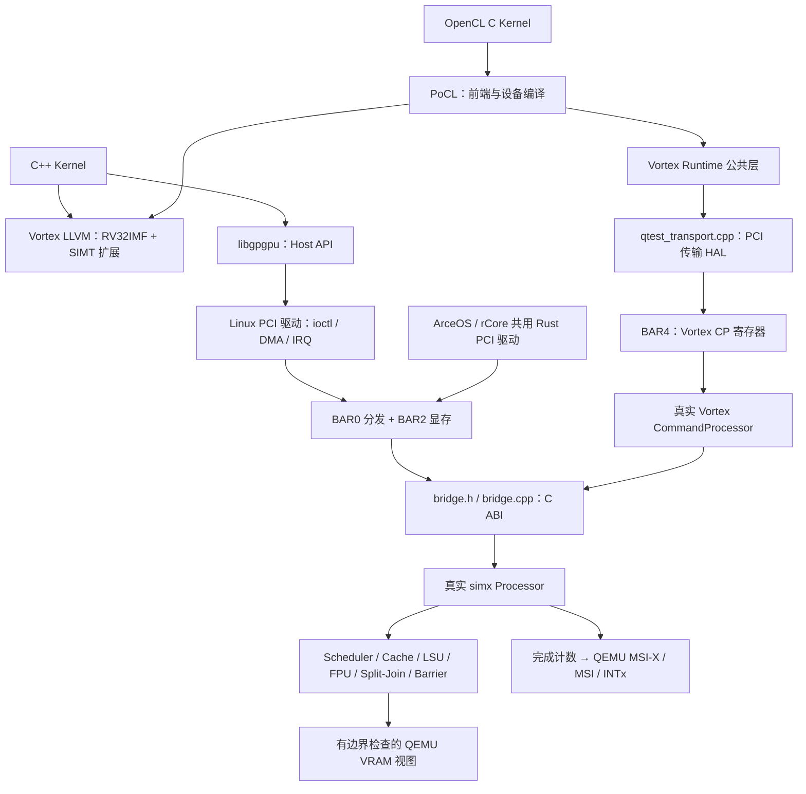

# 进阶实验二：真实 Vortex simx 后端

本目录将 Vortex `Processor` 和 `CommandProcessor` 直接嵌入 QEMU。
源码固定为 `942e381aadd9660128470dc5c0d18ad27d7e0a4b`，预编译
LLVM/PoCL/libc/libcrt 使用 `v3.0.1`。依赖与二进制放在忽略的 `build/`。

## 架构与代码位置



| 组件 | 文件 | 职责 |
|---|---|---|
| PCI 前端 | `hw/gpgpu/gpgpu.c`, `gpgpu.h` | 后端选择、显存视图、PCI DMA、定时推进、中断与复位 |
| 可选后端加载 | `hw/gpgpu/gpgpu_vortex.c` | Linux 动态加载、SoftFloat 符号隔离、配置检查与生命周期 |
| C/C++ 接口 | `bridge.h`, `bridge.cpp` | Processor、KMU、CP、周期上限与 ABI/配置检查 |
| 设备 ABI | `start.S`, `kernel.ld` | 启动 `0x10000`、C 入口 `0x10040`、CSR 参数与独立栈 |
| 算子与同步 | `kernels.cpp`, `sync.cpp`, `local.cpp` | 三个算子、跨 warp 屏障、分支与共享内存 |
| 原生 sgemm | 上游 `tests/regression/sgemm/kernel.cpp` | 保留计算代码，编译时适配入口名为 `gpgpu_kernel` |
| OpenCL HAL | `qtest_transport.cpp` | 上游 callbacks ABI，PCI 寄存器与主机暂存内存 |
| 设备 CRT | `crt.c` | 实现 newlib 初始化入口，调用构造函数数组，链接预编译 musl |
| 两套 OS 驱动 | `os_driver.rs`, `prepare-os.py` | ECAM/BAR、地址转换、双向 DMA、PLIC claim/complete、调度 |
| 构建与验证 | `build.py`, `run-opencl.py`, `run-os.py`, `test-simx.py` | 固定依赖、构建、执行与结果检查 |

默认 `-device gpgpu` 使用基础解释器。显式选择 simx 后，由真实模拟器执行；
加载失败或配置不匹配直接报错：

```sh
-device gpgpu,backend=simx,simx_library=/absolute/path/build/gpgpu-vortex/libgpgpu-vortex.so
```

配置为 4 cores × 4 warps × 32 lanes，block 最多 128 个线程。cache、scheduler、
RAM/DRAM 时序、split/join 和 barrier 模型均参与执行。QEMU 每次推进至多
256 周期，通过虚拟定时器继续执行；单个 kernel 最多 10,000,000 周期。
PCI 回调留在 QEMU 事件线程，simx host workers 固定为 1。这限制模拟器的宿主
线程数；模拟 GPU 仍有多 core、多 warp、多 lane。

## 软件入口与指令适配

**libgpgpu / OS 入口。** Host API 和 Linux 驱动沿用进阶实验一。设备代码改用
Vortex LLVM、`vx_spawn2.h`、原生 CSR 与 split/join。参数字节布局保持一致，
参数地址通过 MSCRATCH 传入 `a0`。startup 根据 MHARTID 建立每硬件 lane 的
8 KiB 栈，由桥接层在 Vortex 原生高地址窗口提供。代码与普通数据访问 BAR2 的
64 MiB 显存；Linux 进阶一驱动的栈分配保持兼容，但 simx 不使用它。

**PoCL/OpenCL 入口。** 真实 OpenCL Host 程序调用固定版本 PoCL；PoCL 使用
Vortex LLVM 生成 RV32 程序和 `.vxbin`，通过 Vortex Runtime 公共层提交命令。
适配集中在 callbacks HAL：BAR4 `0x1000..0x11ff` 映射真实 CP 寄存器，CP
经 PCI DMA 访问 QEMU RAM 中的 ring、暂存区、完成序号。HAL 实现 staging
push/pull 与 doorbell 发布时的 ring 同步；HAL 自身不执行 GPU 指令。

OpenCL 控制端在 x86 Linux 上经 QTest 操作 PCI，与 OS 启动测试是两条验证路径。
**未声称 PoCL 已在 ArceOS/rCore 用户态运行。** 两套 OS 实际启动各自内核、
地址空间和 PLIC，运行共用 PCI 驱动。ArceOS 用 paging 映射 BAR；rCore 在内存
初始化后验证并关机，不进入 shell。驱动轮询完成状态，claim/complete 真实
PLIC INTx，尚未改为异步 OS 中断回调。

## 构建与执行

需要 Linux、G++ 11、CMake、Make、Python 3.12+、系统 LLD、OpenCL ICD loader，
以及 RV32 ILP32F multilib/newlib GCC。OS 需要 Rust stable、rust-src、llvm-tools
和 `riscv64gc-unknown-none-elf`；ArceOS 构建启用 RUSTC_BOOTSTRAP。本机 GCC
位于 `/home/baiyifan/riscv/riscv64-multilib`，可用 `--riscv-gnu` 替换。

在 QEMU 仓库根目录运行：

```sh
python3 contrib/gpgpu/vortex/build.py fetch
python3 contrib/gpgpu/vortex/build.py tools
python3 contrib/gpgpu/vortex/build.py simx
python3 contrib/gpgpu/vortex/build.py opencl --riscv-gnu /path/to/multilib
python3 contrib/gpgpu/vortex/build.py os
env PATH=/usr/bin:/bin ninja -C build -j16 qemu-system-riscv64 tests/qtest/qos-test

python3 contrib/gpgpu/vortex/test-simx.py
python3 contrib/gpgpu/vortex/run-opencl.py --riscv-gnu /path/to/multilib
python3 contrib/gpgpu/vortex/run-os.py arceos
python3 contrib/gpgpu/vortex/run-os.py rcore
```

可使用 `build.py all`。脚本只适配 `build/deps/` 中固定版本的可丢弃 OS 副本；
Git 下载停滞时使用同一提交的源码归档，并把 Cargo 依赖指向本地路径。
不修改外部 OS 仓库。G++ 11 避免旧 fmt 与新版 GCC 的诊断冲突；不关闭
`-Werror`，不修改上游 simx 指令逻辑。

Linux 沿用进阶一的真实驱动与静态 Host demo。将 `build/gpgpu-sdk/gpgpu-demo`
以及 `driver/gpgpu_pci.ko` 放入 `build/gpgpu-vortex/` 下相同相对位置，使用
`scripts/mkinitramfs.py --sdk build/gpgpu-vortex` 打包，再用
`scripts/run-linux.py --device` 指定上述 simx 属性启动。

## 已验证结果

2026-10-15，`riscv64-softmmu`：

| 验证 | 结果 |
|---|---|
| 原 17 项计分 QTest + 8 项补充回归 | 25/25 通过；原始测试文件未修改 |
| Linux 6.6 + libgpgpu + simx | vector add、ReLU、matmul、BAR2 mmap 全部通过 |
| 双 warp 全局内存屏障与分支 | 64 输出通过；665 cycles、32 memory requests、2 divergence |
| 双 warp 本地共享内存屏障与分支 | 64 输出通过；613 cycles、20 memory requests、累计 4 divergence |
| 上游 C++ sgemm | 8×8，64 输出逐项通过 |
| CTA 重用与尾部线程 | 9 blocks，550 输出正确，26 个越界 lane 保持未写入 |
| 上游 PoCL/OpenCL sgemm | 32×32，PASSED；298,656 instructions、193,223 cycles |
| 真实 simx MSI-X | 完成、错误、非法访存后的复位与再调度通过 |
| ArceOS | PCI、双向 DMA、PLIC INTx、vecadd、barrier、divergence 通过 |
| rCore | 同上，通过 |

日志：`build/gpgpu-vortex/{linux-demo,simx-tests,opencl-sgemm,arceos-demo,rcore-demo}.log`。
BAR4 `0x2000/0x2004/0x2008` 提供周期、当前 launch 的内存请求数、core 0 累计
divergence 的低 32 位。

错误复位销毁并重建 Processor。上游普通 reset 要求排空状态；finalize 丢弃
事务后仍保留全局 channel 预留计数。桥接层在唯一 Processor 完全销毁后清零
计数，避免新内核无法判定排空。专项测试覆盖此恢复路径。
此处是固定版本的集成补丁；后续应在上游 `SimPlatform::cleanup()` 完成 channel
计数清理，发布对应版本后移除桥接层的清零操作。

## 能力边界

- simx 与基础解释器的 ABI/CSR 不同。BF16/FP8/FP4 自定义编码仅在基础解释器
  中验证，未添加到 Vortex。
- 地址为设备物理地址/显存偏移，GPU VM 关闭。无共享虚拟地址、UVM、缺页迁移、
  抢占、多进程隔离；内核和动态库需要可信。
- 限制一个 simx 实例，客户端串行提交。
- 上游 Runtime 的 allocator 常量为 4 GiB，本设备显存为 64 MiB。已验证的
  小规模 workload 在范围内，大容量配置和 allocator 上限对齐尚未实现。
- 未验证迁移、RTL、FPGA 或 ROCm/HIP 二进制兼容。实际链路为 OpenCL →
  Vortex LLVM → RV32/SIMT；NVIDIA PTX 和 AMD ISA 不能直接执行。
